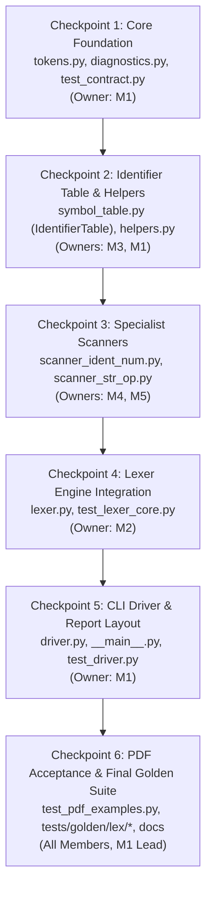

# Mini Java Compiler: Phase 1 Integration and Testing Strategy

**Course:** CSCI415 – Compiler Design (Fall 2026)  
**Project Title:** Mini Java Compiler — Phase 1: Lexical Analysis  
**Authoritative Specification:** `/home/yousefmahmoudali/Desktop/CompilerProject/Projects/ProjectGuidelinesAndDetails.pdf`  
**Shared Contract:** `/home/yousefmahmoudali/Desktop/CompilerProject/Projects/Phase 1/SHARED_PROJECT_CONTRACT.md`  
**Phase 1 Target Deadline:** **October 30, 2026**  

---

## 1. Incremental Integration Sequence for Phase 1

To avoid integration bottlenecks and detect interface incompatibilities early, Phase 1 components are integrated in six sequential checkpoints:



---

## 2. Checkpoint Verification Matrix

| Checkpoint | Scope & Modules | Dependencies | Verification Actions | Responsible Member | Exit Criteria |
|---|---|---|---|---|---|
| **CP-1: Core Contracts** | `minijava/tokens.py`<br>`minijava/diagnostics.py`<br>`tests/test_contract.py` | None | 1. Byte-compile with `compileall`<br>2. Run `python3 -m unittest tests.test_contract` | Member 1 | All token types, keywords, operators, delimiters, and diagnostic templates defined and verified. |
| **CP-2: Symbol Table** | `minijava/symbol_table.py`<br>`tests/helpers.py`<br>`tests/test_symbol_table.py` | CP-1 | 1. Run `python3 -m unittest tests.test_symbol_table`<br>2. Verify `add_occurrence` coordinate tracking | Member 3 (author), Member 1 (review) | `IdentifierTable` accurately tracks multiple occurrences and appearance index. |
| **CP-3: Specialist Scanners** | `minijava/scanner_ident_num.py`<br>`minijava/scanner_str_op.py` | CP-1, CP-2 | 1. Run `test_scanner_ident_num.py`<br>2. Run `test_scanner_str_op.py` | Member 4, Member 5 | Valid numbers, strings, keywords, operators scanned cleanly; invalid identifiers and unclosed strings detected. |
| **CP-4: Lexer Engine** | `minijava/lexer.py`<br>`tests/test_lexer_core.py` | CP-3 | 1. Run `test_lexer_core.py`<br>2. Test comment and whitespace skipping<br>3. Verify EOF token generation | Member 2 (author), Member 1 (review) | Central `Lexer` integrates sub-scanners; reports `LEX_UNCLOSED_COMMENT` and `LEX_INVALID_CHARACTER`. |
| **CP-5: CLI Driver** | `minijava/driver.py`<br>`minijava/__main__.py`<br>`tests/test_driver.py` | CP-4 | 1. Run `test_driver.py`<br>2. Run CLI: `python3 -m minijava sample.mj --phase lex`<br>3. Verify exit codes (0, 1, 2) | Member 1 (author), Member 2 (review) | Driver correctly coordinates file reading and prints standard formatted sections. |
| **CP-6: Acceptance & Sign-off** | All modules, `samples/phase1_tests.txt`, `docs/phase1_report.md` | CP-5 | 1. Run `test_pdf_examples.py`<br>2. Run `tests/golden/lex/*`<br>3. Full suite: `python3 -m unittest discover` | All Members (M1 leads) | 100% test pass rate across all suites; PDF sample matches verbatim; Phase 1 report complete. |

---

## 3. Layered Testing Strategy for Phase 1

The Phase 1 quality assurance strategy uses four testing layers:

```
           ▲
          / \     Layer 4: Course Acceptance Suite (PDF p. 3–5 Examples)
         /-----\
        /       \ Layer 3: Independent Golden Test Suite (tests/golden/lex/)
       /---------\
      /           \ Layer 2: CLI Integration & Driver Suite (test_driver.py)
     /-------------\
    /               \ Layer 1: Focused Unit Suites (tokens, symbols, scanners, lexer)
   /-----------------\
```

### Layer 1: Focused Unit Test Suites
- `tests/test_contract.py` (M1): Validates class signatures, dataclass fields, and enum members via reflection.
- `tests/test_symbol_table.py` (M3): Validates identifier index, first-seen coordinates, and occurrence lists.
- `tests/test_scanner_ident_num.py` (M4): Validates keywords, identifiers, float/int literals, and digit-prefixed invalid identifiers.
- `tests/test_scanner_str_op.py` (M5): Validates string literals, escape sequences, operator maximal munch, and unclosed strings.
- `tests/test_lexer_core.py` (M2): Validates whitespace skipping, comments, delimiters, invalid characters, and EOF.

### Layer 2: CLI Driver Suite (`tests/test_driver.py`, M1)
- Validates argument parsing (`--phase lex`, `--tokens`, `--symbols`).
- Verifies exact report layout with section headers:
  `=== Tokens ===`, `=== Symbol Table ===`, `=== Errors ===`, `=== Result ===`.
- Verifies UNIX exit codes: 0 for clean runs, 1 for lexical errors, 2 for CLI/file read errors.

### Layer 3: Independent Golden Test Suite (`tests/golden/lex/`, M5)
- Author at least 15 pairs of `.mj` and `.out` files.
- All `.out` expected outputs are hand-derived from the PDF and contract specifications.
- Tests multi-error recovery, complex expressions, mixed comments, and edge cases.

### Layer 4: Course Acceptance Suite (`tests/test_pdf_examples.py`, M4)
Tests the exact examples from the official PDF (*PDF p. 3–5*):
1. Invalid character error: `int x = 10 @ 5;` -> `Error: invalid character '@' at line 1, column 12.`
2. Invalid identifier error: `1name = 5;` -> `Error: invalid identifier '1name' at line 1, column 1.`
3. Unclosed string error: `String name = "Ali;` -> `Error: unclosed string literal starting at line 1, column 15.`
4. Unclosed comment error: `/* This comment does not end` -> `Error: unclosed comment starting at line 1, column 1.`
5. Full 13-line Mini Java sample program -> asserts that all 41 token lines match the PDF output format verbatim.

---

## 4. Final Submission Acceptance Checklist (Due Oct 30)

Execute and sign off before submitting Phase 1:

```markdown
- [ ] 1. Clean Byte-Compilation:
      `python3 -m compileall -q minijava tests` runs with 0 errors.
- [ ] 2. Zero Banned Libraries:
      Zero occurrences of `import re` or `import tokenize` in `minijava/`.
- [ ] 3. Contract Conformance:
      `python3 -m unittest tests.test_contract -v` passes 100%.
- [ ] 4. All Unit & Integration Tests Pass:
      `python3 -m unittest discover -s tests -t . -v` passes with 0 failures in < 5 seconds.
- [ ] 5. PDF Acceptance Suite Passes:
      `python3 -m unittest tests.test_pdf_examples -v` passes 100%.
- [ ] 6. CLI Driver Verification:
      `python3 -m minijava samples/phase1_tests.txt --phase lex` prints formatted tokens, symbol table, errors, and exit code 0.
- [ ] 7. Submission Deliverables Present:
      - Source code in `minijava/` and `tests/`.
      - `samples/phase1_tests.txt` present and containing comprehensive test programs.
      - `docs/phase1_report.md` present (1–2 pages, addressing tokens, error handling, challenges).
- [ ] 8. Oral Examination Preparation:
      All 5 team members understand their owned modules and can explain them during the grading interview.
```
