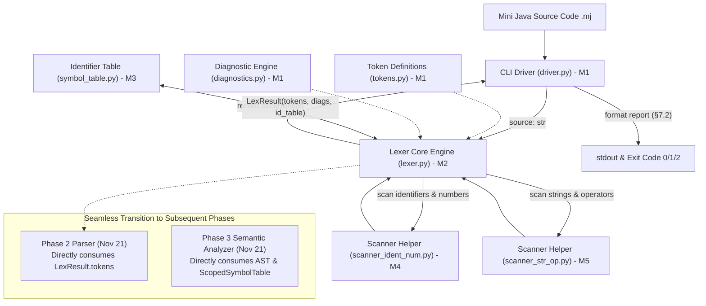
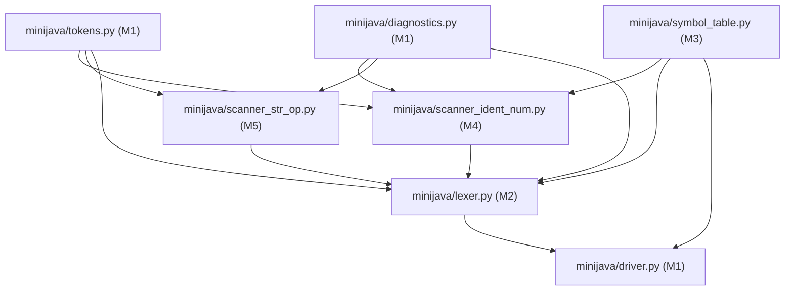

# Mini Java Compiler: Phase 1 Architecture Design and Team Task Allocation Plan

**Course:** CSCI415 - Compiler Design (Fall 2026)  
**Project Title:** Mini Java Compiler - Phase 1: Lexical Analysis  
**Authoritative Specification:** `/home/yousefmahmoudali/Desktop/CompilerProject/Projects/ProjectGuidelinesAndDetails.pdf`  
**Shared Contract:** `/home/yousefmahmoudali/Desktop/CompilerProject/Projects/Phase 1/SHARED_PROJECT_CONTRACT.md`  
**Phase 1 Target Deadline:** **October 30, 2026**  
**Team Composition:** 5 Computer Science Students (Member 1 to Member 5)  

---

## 1. Phase 1 Architecture and Forward Compatibility

### 1.1 Architectural Blueprint
Phase 1 implements a modular, high-performance, hand-crafted **Lexical Analyzer (Scanner)** that transforms raw Mini Java source text into a structured, validated stream of tokens while constructing an identifier symbol table and recording all lexical diagnostics.



### 1.2 Forward-Compatibility Strategy for Phases 2 & 3
To guarantee that Phase 1 code does not require refactoring when Phase 2 (Syntax Analysis) and Phase 3 (Semantic Analysis) are announced in November:
1. **Immutable Token Contracts:** The `Token` class and `TokenType` enums are frozen. The token stream `list[Token]` terminates with an explicit `TokenType.EOF` token, exactly what a recursive-descent parser expects.
2. **Standardized Diagnostics:** The `Diagnostic` dataclass, `Phase` enum (`LEXICAL`, `SYNTAX`, `SEMANTIC`), and `ErrorCode` enum are designed so that future syntax and semantic errors seamlessly plug into the same diagnostic reporting pipeline.
3. **Symbol Table Extensibility:** `minijava/symbol_table.py` provides the concrete `IdentifierTable` required for Phase 1, with a clean architectural hook to add `ScopedSymbolTable` for Phase 3 without altering existing Phase 1 imports or functions.
4. **Driver Phase-Gating:** `minijava/driver.py` supports `--phase lex` as the active Phase 1 execution mode, with dynamic hooks that will call `--phase parse` and `--phase semantic` when those modules become available.

---

## 2. Phase 1 Directory Structure and File Ownership

Every file in the Phase 1 project has exactly **one designated owner**. No member modifies another member's files.

```
CompilerProject/
├── Projects/
│   ├── ProjectGuidelinesAndDetails.pdf   [READ-ONLY] Official course specification
│   └── Phase 1/                          Phase 1 planning deliverables & prompts
│       ├── PROJECT_REQUIREMENTS_ANALYSIS.md
│       ├── PROJECT_ARCHITECTURE_AND_TEAM_PLAN.md
│       ├── SHARED_PROJECT_CONTRACT.md
│       ├── AI_PROMPT_MEMBER_1.md
│       ├── AI_PROMPT_MEMBER_2.md
│       ├── AI_PROMPT_MEMBER_3.md
│       ├── AI_PROMPT_MEMBER_4.md
│       ├── AI_PROMPT_MEMBER_5.md
│       ├── INTEGRATION_AND_TESTING_PLAN.md
│       └── PROJECT_RISK_AND_FINAL_AUDIT.md
├── README.md                             [M1] Build, execution, and test instructions
├── .gitignore                            [M1] Python bytecode and cache ignores
├── minijava/
│   ├── __init__.py                       [M1] Package version string (__version__ = "1.0.0")
│   ├── __main__.py                       [M1] CLI entrypoint delegating to driver.main()
│   ├── tokens.py                         [M1] TokenType, Token dataclass, KEYWORDS, operators, delimiters
│   ├── diagnostics.py                    [M1] Phase, ErrorCode, Diagnostic, make_diagnostic factory
│   ├── driver.py                         [M1] CLI reader, pipeline driver, report layout formatter
│   ├── lexer.py                          [M2] Central Lexer engine, whitespace, comments, delimiters, EOF
│   ├── symbol_table.py                   [M3] IdentifierEntry, IdentifierTable, format_identifier_table
│   ├── scanner_ident_num.py              [M4] Scanner specialist for identifiers, keywords, numbers, invalid ids
│   └── scanner_str_op.py                 [M5] Scanner specialist for strings, escape sequences, operators
├── tests/
│   ├── __init__.py                       [M1] Empty test root
│   ├── helpers.py                        [M1] In-process CLI test runner and token comparison helpers
│   ├── test_contract.py                  [M1] Reflection test suite asserting interface compliance
│   ├── test_driver.py                    [M1] CLI flag, exit code, and section formatting tests
│   ├── test_lexer_core.py                [M2] Core scanner unit tests: whitespace, comments, delimiters, EOF
│   ├── test_symbol_table.py              [M3] Symbol table unit tests: occurrences, ordering, formatting
│   ├── test_scanner_ident_num.py         [M4] Identifier, keyword, number, and invalid identifier tests
│   ├── test_pdf_examples.py              [M4] Exact PDF p. 3-5 regression and sample acceptance suite
│   ├── test_scanner_str_op.py            [M5] String literal, escape code, and operator munch tests
│   └── golden/
│       └── lex/                          [M5] Independent golden test suite (≥ 15 *.mj + *.out cases)
├── samples/
│   └── phase1_tests.txt                  [M3] Official Phase 1 input test programs deliverable
└── docs/
    └── phase1_report.md                  [M3] Official Phase 1 1-2 page technical report deliverable
```

---

## 3. Phase 1 Task Allocation Across Exactly Five Members

The Phase 1 workload is divided across all 5 team members to guarantee balanced implementation, meet the course requirement that all members participate in code (*PDF p. 1*), and ensure everyone is prepared for the oral examination. Workloads sum to **100%**.

| Member | Primary Phase 1 Responsibility | Specific Deliverables | Files Owned | Dependencies | Acceptance Criteria | Estimated Workload |
|---|---|---|---|---|---|:---:|
| **Member 1** | **Lead Architect, Token System, Diagnostics & CLI Driver** | Core token definitions, diagnostic factory, CLI driver, report formatter, shared test helpers, contract conformance test suite | `minijava/tokens.py`<br>`minijava/diagnostics.py`<br>`minijava/driver.py`<br>`minijava/__init__.py`<br>`minijava/__main__.py`<br>`tests/__init__.py`<br>`tests/helpers.py`<br>`tests/test_contract.py`<br>`tests/test_driver.py`<br>`README.md`<br>`.gitignore` | None (provides foundational contracts) | Clean byte-compilation; `test_contract.py` validates all member PRs; driver formats report sections matching §7.2; exit codes 0/1/2 work accurately. | **22%** |
| **Member 2** | **Lexer Engine Core, Comments, Delimiters & Coordination** | Central `Lexer` loop, cursor navigation, 1-based line/col tracking, whitespace skipper, comment skipper, unclosed comment errors, delimiter matching, invalid character detection, token aggregation | `minijava/lexer.py`<br>`tests/test_lexer_core.py` | `tokens.py`<br>`diagnostics.py`<br>`symbol_table.py`<br>`scanner_ident_num.py`<br>`scanner_str_op.py` | `Lexer.tokenize()` integrates helper scanners; tracks coordinates accurately (tab=1 col); skips comments; reports `LEX_UNCLOSED_COMMENT` and `LEX_INVALID_CHARACTER`; ≥ 25 core tests pass. | **20%** |
| **Member 3** | **Identifier Symbol Table & Official Course Deliverables Lead** | `IdentifierTable` tracking index, name, coordinates, occurrences; formatting; official test input programs file; official 1-2 page technical report | `minijava/symbol_table.py`<br>`tests/test_symbol_table.py`<br>`samples/phase1_tests.txt`<br>`docs/phase1_report.md` | `tokens.py`<br>`diagnostics.py` | `IdentifierTable` tracks multiple occurrences; `format_identifier_table` matches §7.4; `samples/phase1_tests.txt` contains diverse programs; `docs/phase1_report.md` completed. | **19%** |
| **Member 4** | **Scanner Specialist: Identifiers, Keywords, Numbers & PDF Acceptance** | Identifier scanning, keyword classification (`class` vs `Class`, `String` vs `STRING_TYPE`, `main`), float/int number scanning, digit-prefix invalid identifier detection (`1name`), PDF p. 3-5 regression suite | `minijava/scanner_ident_num.py`<br>`tests/test_scanner_ident_num.py`<br>`tests/test_pdf_examples.py` | `tokens.py`<br>`diagnostics.py`<br>`symbol_table.py` | `scan_identifier_or_number` handles all numbers and keywords; detects `1name` as `LEX_INVALID_IDENTIFIER`; records to `IdentifierTable`; PDF p. 3-5 tests pass 100%. | **20%** |
| **Member 5** | **Scanner Specialist: Strings, Operators & Independent Test Oracles** | Quoted string scanning (`"..."`, `'...'`), escape sequence handling (`\n`, `\"`, `\'`, `\\`), unclosed string detection, operator scanning with maximal munch (`MATHOP`, `LOGOP`, `ASSIGN`), independent golden tests | `minijava/scanner_str_op.py`<br>`tests/test_scanner_str_op.py`<br>`tests/golden/lex/*` | `tokens.py`<br>`diagnostics.py` | `scan_string` handles quotes/escapes; reports `LEX_UNCLOSED_STRING`; `scan_operator` matches two-char operators before single-char; ≥ 15 golden test cases authored. | **19%** |

---

## 4. Phase 1 Component Dependency Graph



---

## 5. Phase 1 Implementation Schedule and Quality Gates (Target: Oct 30)

| Quality Gate | Target Date | Milestones & Activities | Success Criteria | Responsible |
|---|---|---|---|---|
| **Gate 1: Contracts & Project Setup** | Oct 20 | Repository initialized; `tokens.py`, `diagnostics.py`, and `test_contract.py` frozen | Clean byte-compilation; reflection suite passes; contracts locked | Member 1 (Lead) |
| **Gate 2: Symbol Table & Helper Scanners** | Oct 22 | `symbol_table.py` (`IdentifierTable`), `scanner_ident_num.py`, and `scanner_str_op.py` implemented | Unit tests pass for identifier table, numbers, strings, and operators | Members 3, 4, 5 |
| **Gate 3: Core Scanner Integration** | Oct 24 | `lexer.py` integrates all sub-scanners; whitespace, comments, delimiters, and EOF handled | Lexer emits complete token streams; reports all 4 error types; core tests pass | Member 2 (Lead), Members 4, 5 |
| **Gate 4: CLI Driver & PDF Regression** | Oct 26 | `driver.py` formatted output connected; `test_pdf_examples.py` executed | CLI `--phase lex` matches PDF p. 4-5 sample; all 4 PDF error examples pass | Member 1, Member 4 |
| **Gate 5: Golden Test Suite & Deliverables** | Oct 28 | `samples/phase1_tests.txt` populated; `docs/phase1_report.md` written; golden tests pass | 100% test pass rate across all suites; report verified against PDF p. 5 | Member 3, Member 5 |
| **Gate 6: Final Submission & Oral Rehearsal** | Oct 30 | Code frozen; final package verified; oral presentation dry run completed | Clean run of `python3 -m unittest discover`; all 5 members ready for oral exam | All Members |
