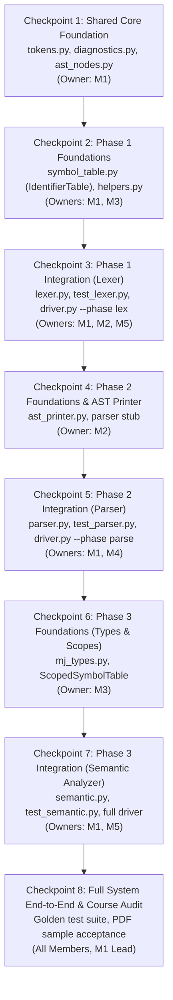

# Mini Java Compiler: Integration and Testing Strategy

**Course:** CSCI415 - Compiler Design (Fall 2026)  
**Project Title:** Mini Java Compiler Integration Plan  
**Authoritative Specification:** `/home/yousefmahmoudali/Desktop/CompilerProject/Projects/ProjectGuidelinesAndDetails.pdf`  
**Shared Contract:** `/home/yousefmahmoudali/Desktop/CompilerProject/planning/SHARED_PROJECT_CONTRACT.md`  
**Document Status:** Official Integration Protocol and Testing Strategy  

---

## 1. Incremental Integration Sequence

To prevent late-stage "big-bang" integration failures, the compiler components will be integrated in a strict, incremental sequence. Each integration step builds upon verified predecessors.



---

## 2. Integration Checkpoints and Verification Matrix

| Checkpoint | Scope & Merged Modules | Dependencies | Verification Actions | Responsible Member | Exit Criteria |
|---|---|---|---|---|---|
| **CP-1: Core Contracts** | `minijava/tokens.py`<br>`minijava/diagnostics.py`<br>`minijava/ast_nodes.py`<br>`tests/test_contract.py` | None | 1. Byte-compile with `compileall`<br>2. Run `python3 -m unittest tests.test_contract` | Member 1 | All shared types, enums, and dataclasses defined and verified. Zero syntax errors. |
| **CP-2: Phase 1 Base** | `minijava/symbol_table.py` (`IdentifierTable`)<br>`tests/helpers.py`<br>`tests/test_symbol_table.py` | CP-1 | 1. Verify `IdentifierTable.add_occurrence`<br>2. Check `format_identifier_table` output formatting | Member 3 (author), Member 1 (review) | `test_symbol_table.py` passes; `helpers.py` provides working CLI harness. |
| **CP-3: Phase 1 CLI (Lexer)** | `minijava/lexer.py`<br>`minijava/driver.py`<br>`tests/test_lexer.py`<br>`tests/golden/lex/*` | CP-2 | 1. Run unit test suite: `test_lexer.py`<br>2. Run lexer golden suite: `test_golden.py`<br>3. Run CLI: `python3 -m minijava sample.mj --phase lex`<br>4. Compare output to PDF p. 4-5 sample | Member 1 (Lead), Member 2, Member 5 | Lexer outputs exact tokens; reports 4 error types; reproduces PDF sample verbatim; Phase 1 deliverable ready. |
| **CP-4: AST Visualizer** | `minijava/ast_printer.py`<br>`tests/test_ast_printer.py` | CP-1 | 1. Construct mock ASTs and format with `format_ast`<br>2. Verify indentation and label formatting | Member 2 (author), Member 4 (review) | `test_ast_printer.py` passes; formatting conforms to contract §6.9. |
| **CP-5: Phase 2 CLI (Parser)** | `minijava/parser.py`<br>`tests/test_parser.py`<br>`tests/test_pdf_examples.py`<br>`tests/golden/parse/*` | CP-3, CP-4 | 1. Run parser unit tests: `test_parser.py`<br>2. Run PDF regression tests: `test_pdf_examples.py`<br>3. Run CLI: `python3 -m minijava <file> --phase parse --ast`<br>4. Verify single-error halting and formatted syntax errors | Member 1 (Lead), Member 4, Member 2 | Recursive-descent parser constructs correct ASTs; operator precedence/associativity verified; PDF examples pass. |
| **CP-6: Phase 3 Foundations** | `minijava/mj_types.py`<br>`ScopedSymbolTable` in `symbol_table.py`<br>`tests/test_mj_types.py` | CP-1, CP-2 | 1. Test assignability, promotion, and operator validity<br>2. Test scope nesting, shadowing, and `lookup_in_method` | Member 3 (author), Member 5 (review) | `test_mj_types.py` and `test_symbol_table.py` pass; type algebra verified. |
| **CP-7: Phase 3 CLI (Semantic)** | `minijava/semantic.py`<br>`tests/test_semantic.py`<br>`tests/golden/semantic/*` | CP-5, CP-6 | 1. Run semantic unit tests: `test_semantic.py`<br>2. Run semantic golden tests<br>3. Run full compiler CLI: `python3 -m minijava <file>`<br>4. Test error suppression and duplicate declaration detection | Member 1 (Lead), Member 5, Member 3 | Semantic analysis correctly reports all `SEM_*` errors; passes all golden cases; scoped symbol table formatted accurately. |
| **CP-8: Final System Audit** | Entire repository, reports, test inputs | CP-7 | 1. Full clean test run: `python3 -m unittest discover -s tests -t . -v`<br>2. CLI exit codes check (0, 1, 2)<br>3. Submission deliverables check against PDF p. 5 | All 5 Members | 100% test pass rate (< 30 seconds); zero unhandled exceptions; full PDF compliance. |

---

## 3. Layered Testing Architecture

The project employs a five-layer testing pyramid to assure correctness and prevent regressions:

```
                  ▲
                 / \
                /   \     Layer 5: Course Acceptance Suite (PDF Samples)
               /-----\
              /       \   Layer 4: Golden End-to-End Suite (Independent Oracles)
             /---------\
            /           \ Layer 3: Component Integration Suite (Pipeline & CLI)
           /-------------\
          /               \ Layer 2: Interface Contract Suite (Reflection & Typing)
         /-----------------\
        /                   \ Layer 1: Focused Unit Suites (Lexer, Parser, Semantics, Types)
       /---------------------\
```

### Layer 1: Unit Test Suites
- **`tests/test_lexer.py` (M2):** ≥ 40 tests testing character scanning, token classification, comments, quotes, escapes, maximal munch, and all 4 lexical error types.
- **`tests/test_symbol_table.py` (M3):** ≥ 25 tests testing `IdentifierTable` tracking and `ScopedSymbolTable` hierarchical lookups.
- **`tests/test_mj_types.py` (M3):** ≥ 20 tests testing type promotion (`int` to `float`), assignability, operator results, and array type rules.
- **`tests/test_ast_printer.py` (M2):** ≥ 20 tests testing canonical AST string formatting across all node variants.
- **`tests/test_parser.py` (M4):** ≥ 40 tests testing all EBNF productions, operator precedence, associativity, dangling-else resolution, and syntax error messages.
- **`tests/test_semantic.py` (M5):** ≥ 45 tests testing multi-pass analysis, scope isolation, type mismatches, argument validation, and return checking.

### Layer 2: Interface Contract Conformance Suite (`tests/test_contract.py`, M1)
- Uses Python's `inspect` and `dataclasses.fields` reflection APIs.
- Automatically inspects every merged module to assert that:
  - Required classes, methods, and functions exist with exact names.
  - Dataclass field names and types match the contract.
  - Enums contain exact contracted keys and values.
  - No unexpected public API modifications have been introduced.

### Layer 3: Component Integration & Driver Suite (`tests/test_driver.py`, M1)
- Tests CLI invocation in-process with intercepted stdout/stderr.
- Verifies `--phase` selection (`lex`, `parse`, `semantic`).
- Verifies display flags (`--tokens`, `--symbols`, `--ast`).
- Verifies exact report section layout and result message strings (§7.2 and §7.3).
- Asserts correct process exit codes (0, 1, 2).

### Layer 4: Golden End-to-End Test Suite (`tests/golden/`, M1, M2, M5)
- Decouples test oracle creation from component implementation:
  - Member 5 creates Lexer golden tests (`tests/golden/lex/`).
  - Member 2 creates Parser golden tests (`tests/golden/parse/`).
  - Member 5 creates Semantic golden tests (`tests/golden/semantic/`).
- Golden test runner (`tests/test_golden.py`) executes each `.mj` file and compares stdout against `.out` hand-derived oracles.

### Layer 5: Course Acceptance Suite (`tests/test_pdf_examples.py`, M4)
- Tests the exact code snippets published in the official course guidelines (*PDF p. 3-5*):
  1. `int x = 10 @ 5;` -> expects `Error: invalid character '@' at line 1, column 12.`
  2. `1name = 5;` -> expects `Error: invalid identifier '1name' at line 1, column 1.`
  3. `String name = "Ali;` -> expects `Error: unclosed string literal starting at line 1, column 15.`
  4. `/* This comment does not end` -> expects `Error: unclosed comment starting at line 1, column 1.`
  5. The full 13-line Mini Java sample program (*PDF p. 4*) -> validates full 41-token stream and successful parsing/semantic analysis.

---

## 4. Shared Test Fixtures and Test Artifacts

| Fixture / Artifact | Location | Owner | Purpose & Consumer |
|---|---|---|---|
| **Test Helper Utilities** | `tests/helpers.py` | Member 1 | In-process CLI runner `run_cli`, mock invocation helpers `lex()`, `parse_source()`, `analyze_source()`. Used by all test files. |
| **Lexer Golden Cases** | `tests/golden/lex/*.mj` + `*.out` | Member 5 | Independent verification cases for scanner tokens, comments, and errors. Consumed by `test_golden.py`. |
| **Parser Golden Cases** | `tests/golden/parse/*.mj` + `*.out` | Member 2 | Independent verification cases for AST printer strings and syntax errors. Consumed by `test_golden.py`. |
| **Semantic Golden Cases** | `tests/golden/semantic/*.mj` + `*.out` | Member 5 | Independent verification cases for semantic errors and scoped symbol tables. Consumed by `test_golden.py`. |
| **Phase 1 Test Programs Deliverable** | `samples/phase1_tests.txt` | Member 3 | Official course deliverable (*PDF p. 5*) containing comprehensive Mini Java test programs for grading. |
| **Phase 2/3 Test Programs Deliverable** | `samples/phase23_tests.txt` | Member 3 | Official course deliverable for Phases 2 and 3 syntax and semantic analysis. |

---

## 5. Final Acceptance and Submission Verification Checklist

Before final submission for any phase, the team must execute and sign off on the following checklist:

```markdown
- [ ] 1. Clean Byte-Compilation:
      `python3 -m compileall -q minijava tests` executes with exit code 0 and zero warnings.
- [ ] 2. Zero External Dependencies:
      No `pip install` required; works cleanly in a fresh Python 3.10+ standard library environment.
- [ ] 3. No Banned Libraries:
      Zero occurrences of `import re`, `import tokenize`, `import ply`, `import lark`, `import antlr4` in `minijava/`.
- [ ] 4. Automated Contract Conformance:
      `python3 -m unittest tests.test_contract -v` passes 100%.
- [ ] 5. Full Test Suite Execution:
      `python3 -m unittest discover -s tests -t . -v` runs all ≥ 190 tests in under 30 seconds with 0 failures and 0 errors.
- [ ] 6. PDF Examples Verification:
      `python3 -m unittest tests.test_pdf_examples -v` passes 100%.
- [ ] 7. CLI End-to-End Validation:
      - Phase 1: `python3 -m minijava samples/phase1_tests.txt --phase lex` produces formatted token stream and exit code 0.
      - Error handling: Malformed input produces exit code 1 with exact PDF message formatting.
      - CLI failure: Nonexistent file produces exit code 2.
- [ ] 8. Submission Artifacts Present:
      - Phase 1 Deliverable 1: Source code in `minijava/` and `tests/`.
      - Phase 1 Deliverable 2: `samples/phase1_tests.txt` present and populated.
      - Phase 1 Deliverable 3: `docs/phase1_report.md` present (1-2 pages, covering tokens, error handling, challenges).
- [ ] 9. Oral Examination Readiness:
      All 5 team members have conducted a dry-run code walkthrough and can explain their assigned modules.
```
