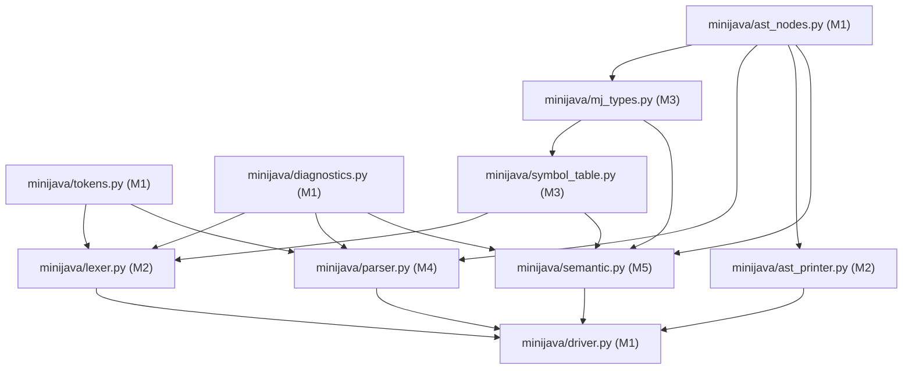

# Mini Java Compiler: Architecture Design and Team Task Allocation Plan

**Course:** CSCI415 - Compiler Design (Fall 2026)  
**Authoritative Specification:** `/home/yousefmahmoudali/Desktop/CompilerProject/Projects/ProjectGuidelinesAndDetails.pdf`  
**Shared Contract:** `/home/yousefmahmoudali/Desktop/CompilerProject/planning/SHARED_PROJECT_CONTRACT.md`  
**Team Composition:** 5 Computer Science Students (Member 1 to Member 5)  
**Document Status:** Official Architectural Blueprint & Team Operating Plan  

---

## 1. Architectural Blueprint

### 1.1 Architectural Style & Pipeline
The Mini Java compiler front-end follows a clean **multi-stage linear pipeline** architecture with strict **unidirectional data flow**. The system deliberately prohibits circular dependencies, shared mutable global state, and direct out-of-band communication between stages.

```mermaid
flowchart LR
    SourceFile[Source File .mj] --> Driver[CLI Driver / Entrypoint]
    Driver -->|source: str| Lexer[Phase 1: Lexical Analyzer]
    Lexer -->|LexResult: tokens, diags, id_table| Driver
    Driver -->|tokens: list[Token]| Parser[Phase 2: Syntax Analyzer]
    Parser -->|ParseResult: program AST, diags| Driver
    Driver -->|program: Program| Semantic[Phase 3: Semantic Analyzer]
    Semantic -->|SemanticResult: scoped_table, diags| Driver
    Driver -->|CompilationResult| Formatter[Report Formatter]
    Formatter -->|Formatted Text| Stdout[stdout / exit code]
```

### 1.2 Component Responsibilities and Boundary Contracts

| Stage / Component | Python Module | Responsible Member | Inputs | Outputs | Primary Responsibility |
|---|---|---|---|---|---|
| **Driver & CLI** | `minijava/driver.py`<br>`minijava/__main__.py` | Member 1 | CLI args, Mini Java source text | `CompilationResult`, stdout text, exit code | Reads files with BOM-tolerant UTF-8, orchestrates phases, handles stopping on error, formats uniform diagnostic report |
| **Shared Tokens** | `minijava/tokens.py` | Member 1 | None | `TokenType`, `Token`, lookup constants | Defines immutable token representations, keyword dictionary, operator sets, delimiter tables |
| **Shared Diagnostics** | `minijava/diagnostics.py` | Member 1 | None | `Diagnostic`, `ErrorCode`, `Phase`, `make_diagnostic` | Standardizes all compiler error reporting; ensures exact PDF-compliant messages |
| **Shared AST Model** | `minijava/ast_nodes.py` | Member 1 *(M4 review)* | None | Immutable AST dataclasses | Formalizes complete AST hierarchy for expressions, statements, methods, and classes |
| **Lexical Analyzer** | `minijava/lexer.py` | Member 2 | `source: str` | `LexResult` (tokens, diagnostics, identifier table) | Hand-crafted character scanner; skips comments/whitespace; identifies tokens; tracks positions |
| **AST Printer** | `minijava/ast_printer.py` | Member 2 | `Program` AST | Formatted AST string (`str`) | Produces canonical two-space indented AST text for Phase 2 visualization and golden testing |
| **Symbol Tables** | `minijava/symbol_table.py` | Member 3 | Declarations, occurrences | `IdentifierTable`, `ScopedSymbolTable` | Phase 1 identifier occurrence index; Phase 3 hierarchical lexical scopes (global, class, method, block) |
| **Type System** | `minijava/mj_types.py` | Member 3 | AST types, operator tokens | `MJType`, type checking functions | Implements Mini Java type algebra, numeric promotion, assignability, binary/unary operator validity |
| **Syntax Analyzer** | `minijava/parser.py` | Member 4 | `list[Token]` | `ParseResult` (`Program` AST or syntax diagnostic) | Hand-crafted recursive-descent parser; enforces operator precedence; builds AST; single-error reporting |
| **Semantic Analyzer** | `minijava/semantic.py` | Member 5 | `Program` AST | `SemanticResult` (scoped table, diagnostics) | Multi-pass static type checker; builds symbol scopes; validates declarations, assignments, calls, and returns |

### 1.3 Error Propagation Strategy
To guarantee complete determinism and prevent runtime crashes:
1. **No Cross-Boundary Exceptions for User Errors:** User code errors (lexical, syntax, semantic) are **never** communicated across component boundaries via thrown exceptions. Every compiler stage returns an explicit result object containing a `diagnostics: list[Diagnostic]` attribute.
2. **Phase-Gated Execution:**
   - If `Lexer` produces one or more diagnostics, the pipeline halts immediately after Phase 1. `Parser` is not invoked.
   - If `Parser` produces a diagnostic, the pipeline halts immediately after Phase 2. `SemanticAnalyzer` is not invoked.
   - This eliminates cascading phantom errors in downstream stages caused by incomplete or malformed inputs.
3. **Internal Exceptions:** Python exceptions (`ValueError`, `RuntimeError`) are strictly reserved for internal compiler logic defects or contract violations (e.g., passing a token list without an `EOF` token to `Parser`).

---

## 2. Complete Project Directory Structure and File Ownership

Every file in the repository has exactly **one designated owner**. No member may modify a file owned by another member without an approved contract change request.

```
/home/yousefmahmoudali/Desktop/CompilerProject/
├── Projects/
│   └── ProjectGuidelinesAndDetails.pdf   [READ-ONLY] Official course specification
├── README.md                             [M1] Build, run, test, and CLI instructions
├── .gitignore                            [M1] Python bytecode, cache, and artifact ignores
├── planning/                             [M1] Architecture, contract, and AI prompt documents
│   ├── PROJECT_REQUIREMENTS_ANALYSIS.md  [M1] Official requirements breakdown
│   ├── PROJECT_ARCHITECTURE_AND_TEAM_PLAN.md [M1] Architectural design and team plan
│   ├── SHARED_PROJECT_CONTRACT.md        [M1] Frozen shared contract (single source of truth)
│   ├── AI_PROMPT_MEMBER_1.md             [M1] Implementation prompt for Member 1
│   ├── AI_PROMPT_MEMBER_2.md             [M1] Implementation prompt for Member 2
│   ├── AI_PROMPT_MEMBER_3.md             [M1] Implementation prompt for Member 3
│   ├── AI_PROMPT_MEMBER_4.md             [M1] Implementation prompt for Member 4
│   ├── AI_PROMPT_MEMBER_5.md             [M1] Implementation prompt for Member 5
│   ├── INTEGRATION_AND_TESTING_PLAN.md   [M1] Incremental integration sequence
│   ├── PROJECT_RISK_AND_FINAL_AUDIT.md   [M1] Risk analysis and consistency audit
│   └── CONTRACT_CHANGES.md               [M1] Formal log of interface change requests
├── minijava/
│   ├── __init__.py                       [M1] Package version string
│   ├── __main__.py                       [M1] CLI entrypoint delegating to driver.main()
│   ├── driver.py                         [M1] File reader, pipeline coordinator, output formatter
│   ├── tokens.py                         [M1] Verbatim Appendix A: TokenType, Token, lookup tables
│   ├── diagnostics.py                    [M1] Verbatim Appendix B: Diagnostic, ErrorCode, Phase
│   ├── ast_nodes.py                      [M1] Verbatim Appendix C: AST dataclass hierarchy (M4 reviewer)
│   ├── lexer.py                          [M2] Hand-crafted lexical analyzer and scanner
│   ├── ast_printer.py                    [M2] Canonical 2-space indented AST string formatter
│   ├── symbol_table.py                   [M3] IdentifierTable (Phase 1) & ScopedSymbolTable (Phase 3)
│   ├── mj_types.py                       [M3] MJType definitions and Mini Java type checking algebra
│   ├── parser.py                         [M4] Hand-crafted recursive-descent syntax analyzer
│   └── semantic.py                       [M5] Multi-pass semantic analyzer and type checker
├── tests/
│   ├── __init__.py                       [M1] Test package root
│   ├── helpers.py                        [M1] Shared test fixtures, CLI runners, and assertion helpers
│   ├── test_contract.py                  [M1] Automated reflection suite verifying interface contracts
│   ├── test_driver.py                    [M1] CLI argument, exit code, and report formatting tests
│   ├── test_golden.py                    [M1] Golden test runner executing all tests/golden/**/*.mj
│   ├── test_lexer.py                     [M2] Lexer unit and edge-case test suite (≥ 40 tests)
│   ├── test_ast_printer.py               [M2] AST printer formatting test suite (≥ 20 tests)
│   ├── test_symbol_table.py              [M3] Symbol table unit test suite (≥ 25 tests)
│   ├── test_mj_types.py                  [M3] Type algebra and operation validity test suite (≥ 20 tests)
│   ├── test_parser.py                    [M4] Parser grammar, precedence, and error tests (≥ 40 tests)
│   ├── test_pdf_examples.py              [M4] Exact PDF p. 3-5 code snippet regression suite
│   ├── test_semantic.py                  [M5] Semantic analysis and scope error test suite (≥ 45 tests)
│   └── golden/
│       ├── lex/                          [M5] Independent oracle: *.mj + *.out for lexer (≥ 12 cases)
│       ├── parse/                        [M2] Independent oracle: *.mj + *.out for parser (≥ 10 cases)
│       └── semantic/                     [M5] Independent oracle: *.mj + *.out for semantics (≥ 15 cases)
├── samples/
│   ├── phase1_tests.txt                  [M3] Official Phase 1 input test programs deliverable
│   └── phase23_tests.txt                 [M3] Official Phase 2 & 3 input test programs deliverable
└── docs/
    ├── phase1_report.md                  [M3] Official Phase 1 1-2 page technical report
    └── phase23_report.md                 [M3] Official Phase 2 & 3 technical report
```

---

## 3. Global Implementation Conventions

All team members and AI assistants must follow these technical conventions:
1. **Target Runtime:** Python ≥ 3.10 (tested and verified with Python 3.10 through 3.14). Standard library only. No `pip install` or external packages.
2. **Banned Modules:** Under Course Requirement REQ-05 (*PDF p. 1*), the following modules and functions are strictly forbidden in `minijava/`:
   `re`, `tokenize`, `ast`, `shlex`, `ply`, `lark`, `antlr4`, `sly`, `pyparsing`. `str.split()` and `str.find()` may not be used to tokenize source code.
3. **Character Handling:** Use explicit ASCII comparisons (e.g. `'a' <= c <= 'z'` or `c in '0123456789'`). Do not use `str.isalpha()` or `str.isdigit()`, which return `True` for non-ASCII Unicode characters.
4. **Position Indexing:** All line and column numbers are **1-based**. The first character of a file is line 1, column 1. Tab characters (`\t`) advance the column counter by 1.
5. **Code Style & Typing:** Adhere to PEP 8. Max line length 100 characters. 4-space indentation. All public classes, functions, and methods must have complete type annotations and descriptive docstrings.
6. **File Encoding:** Source code is read with `encoding='utf-8-sig'` to transparently handle byte order marks (BOM). Newlines are normalized via universal newlines. Files must terminate with a final newline (`\n`).
7. **No Code Stubs:** No placeholder `pass`, `TODO`, or `raise NotImplementedError` is permitted in committed code for contracted behaviors.

---

## 4. Task Allocation Across Exactly Five Members

Work is distributed across five balanced, cohesive roles. Workload percentages sum to exactly **100%**.

| Member | Role | Primary Responsibility | Specific Deliverables | Files Owned | Dependencies | Acceptance Criteria | Workload |
|---|---|---|---|---|---|---|---|
| **Member 1** | Lead Architect & Integration Lead | Shared data models, driver, test runner, integration gatekeeper | `minijava/tokens.py`<br>`minijava/diagnostics.py`<br>`minijava/ast_nodes.py`<br>`minijava/driver.py`<br>`minijava/__main__.py`<br>`tests/helpers.py`<br>`tests/test_contract.py`<br>`tests/test_golden.py`<br>`README.md` | `minijava/tokens.py`<br>`minijava/diagnostics.py`<br>`minijava/ast_nodes.py`<br>`minijava/driver.py`<br>`minijava/__init__.py`<br>`minijava/__main__.py`<br>`tests/__init__.py`<br>`tests/helpers.py`<br>`tests/test_contract.py`<br>`tests/test_driver.py`<br>`tests/test_golden.py`<br>`README.md`<br>`.gitignore`<br>`planning/*` | None (provides foundational contracts) | Byte-compiles cleanly; `test_contract.py` validates all member PRs; driver formats reports matching §7.2; CLI exit codes correct | **22%** |
| **Member 2** | Lexer Engineer & AST Visualizer | Hand-crafted scanner (Phase 1) and canonical AST printer (Phase 2) | `minijava/lexer.py`<br>`minijava/ast_printer.py`<br>`tests/test_lexer.py`<br>`tests/test_ast_printer.py`<br>`tests/golden/parse/*.mj` + `*.out` | `minijava/lexer.py`<br>`minijava/ast_printer.py`<br>`tests/test_lexer.py`<br>`tests/test_ast_printer.py`<br>`tests/golden/parse/*` | `tokens.py`<br>`diagnostics.py`<br>`symbol_table.py`<br>`ast_nodes.py` | Lexer handles all tokens, escapes, comments, invalid ids, unclosed comments/strings; matches PDF sample output; ≥ 40 lexer tests; AST printer handles all AST nodes | **20%** |
| **Member 3** | Symbol Table & Types Engineer | Symbol tables (Phases 1 & 3), type algebra, official submission docs | `minijava/symbol_table.py`<br>`minijava/mj_types.py`<br>`tests/test_symbol_table.py`<br>`tests/test_mj_types.py`<br>`samples/phase1_tests.txt`<br>`samples/phase23_tests.txt`<br>`docs/phase1_report.md`<br>`docs/phase23_report.md` | `minijava/symbol_table.py`<br>`minijava/mj_types.py`<br>`tests/test_symbol_table.py`<br>`tests/test_mj_types.py`<br>`samples/*`<br>`docs/*` | `tokens.py`<br>`diagnostics.py`<br>`ast_nodes.py` | `IdentifierTable` and `ScopedSymbolTable` implement all methods; `mj_types.py` models all type rules and promotions; test files contain comprehensive test cases; 1-2 page reports completed | **19%** |
| **Member 4** | Syntax Analyzer (Parser) Engineer | Hand-crafted recursive-descent parser (Phase 2) | `minijava/parser.py`<br>`tests/test_parser.py`<br>`tests/test_pdf_examples.py` | `minijava/parser.py`<br>`tests/test_parser.py`<br>`tests/test_pdf_examples.py` | `tokens.py`<br>`diagnostics.py`<br>`ast_nodes.py` | Hand-crafted recursive descent; operator precedence and left-associativity; correct AST construction; single syntax error reporting with exact format; ≥ 40 parser tests; PDF examples pass | **20%** |
| **Member 5** | Semantic Analyzer & Test Oracle Lead | Static semantic analyzer (Phase 3) and independent test oracles | `minijava/semantic.py`<br>`tests/test_semantic.py`<br>`tests/golden/lex/*`<br>`tests/golden/semantic/*` | `minijava/semantic.py`<br>`tests/test_semantic.py`<br>`tests/golden/lex/*`<br>`tests/golden/semantic/*` | `ast_nodes.py`<br>`diagnostics.py`<br>`symbol_table.py`<br>`mj_types.py` | Multi-pass analysis; class, method, and block scoping; type compatibility; assignment, binary, unary, call, and return checking; ≥ 45 semantic tests; independent lex & semantic golden cases | **19%** |

---

## 5. Dependency Graph and Parallelization

### 5.1 Component Dependency Graph



### 5.2 Critical Path and Parallel Implementation Schedule
1. **Milestone 1 & 2 (Foundation):** M1 delivers `tokens.py`, `diagnostics.py`, and `ast_nodes.py`. Once these three files are frozen, parallel implementation begins immediately.
2. **Phase 1 Parallel Track:**
   - M3 implements `IdentifierTable` in `symbol_table.py`.
   - M2 implements `lexer.py` using `tokens.py`, `diagnostics.py`, and `symbol_table.py`.
   - M5 authors independent lexer golden tests (`tests/golden/lex/`).
   - M1 implements `driver.py` and `tests/helpers.py`.
3. **Phase 2 & 3 Parallel Track:**
   - M3 implements `mj_types.py` and `ScopedSymbolTable` in `symbol_table.py`.
   - M4 implements `parser.py` (Phase 2 core).
   - M2 implements `ast_printer.py` and authors parser golden tests (`tests/golden/parse/`).
   - M5 implements `semantic.py` (Phase 3 core) and authors semantic golden tests (`tests/golden/semantic/`).
   - M1 coordinates incremental integration on the `integration` branch.

---

## 6. Project Milestones and Quality Gates

| Milestone | Target Horizon | Deliverables | Success & Completion Criteria | Responsible |
|---|---|---|---|---|
| **MS-1: Architecture & Contract Approval** | Day 1 | `SHARED_PROJECT_CONTRACT.md`, directory structure, git branch setup | All 5 members approve contract; git repository initialized with `main` and `integration` | All Members (M1 leads) |
| **MS-2: Shared Core Data Models** | Day 2 | `tokens.py`, `diagnostics.py`, `ast_nodes.py`, `tests/test_contract.py` | Byte-compiles; contract suite tests pass; files frozen under contract change control | Member 1 |
| **MS-3: Phase 1 Foundations** | Days 3-4 | `symbol_table.py` (`IdentifierTable`), `tests/helpers.py`, lexer stub | `IdentifierTable` passes unit tests; test helpers ready for mock token streams | Member 3, Member 1 |
| **MS-4: Phase 1 Implementation & Lexer Validation** | Days 5-7 | `lexer.py`, `test_lexer.py`, `samples/phase1_tests.txt`, `docs/phase1_report.md` | Lexer passes ≥ 40 unit tests; reproduces PDF p. 4-5 sample output exactly; reports all 4 error types; Phase 1 report drafted | Member 2, Member 3, Member 5 |
| **MS-5: Phase 1 Integration Checkpoint** | Day 8 | Phase 1 CLI integration (`python3 -m minijava <file> --phase lex`) | `test_driver.py` passes; golden lexer tests pass; Phase 1 submission package verified | Member 1 (Lead), Member 2, Member 3 |
| **MS-6: Phase 2 Parser & AST Generation** | Days 9-14 | `parser.py`, `ast_printer.py`, `test_parser.py`, `test_ast_printer.py` | Parser handles all grammar rules, precedence, associativity; reports syntax errors; AST printer formats AST; ≥ 40 parser tests pass | Member 4, Member 2 |
| **MS-7: Phase 3 Type System & Scoped Symbol Table** | Days 15-18 | `mj_types.py`, `ScopedSymbolTable`, `test_symbol_table.py`, `test_mj_types.py` | Scope enter/reenter/exit passes; all type promotion and assignability rules tested; ≥ 40 tests pass | Member 3 |
| **MS-8: Phase 3 Semantic Analysis Implementation** | Days 19-24 | `semantic.py`, `test_semantic.py`, `samples/phase23_tests.txt`, `docs/phase23_report.md` | Multi-pass analysis; all SEM error codes reported; passes ≥ 45 semantic tests; golden semantic tests pass | Member 5, Member 3 |
| **MS-9: Full System Integration & Submission Audit** | Days 25-28 | Full end-to-end pipeline, final reports, presentation walkthrough rehearsal | `python3 -m unittest discover` runs 100% clean; PDF examples verified; all 5 members pass code walkthrough | All Members (M1 leads) |
